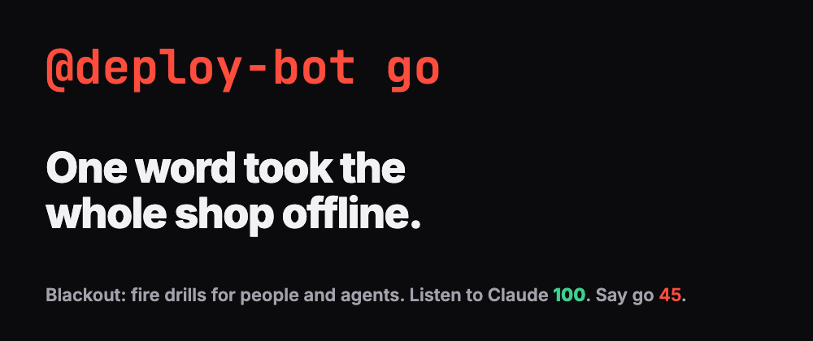
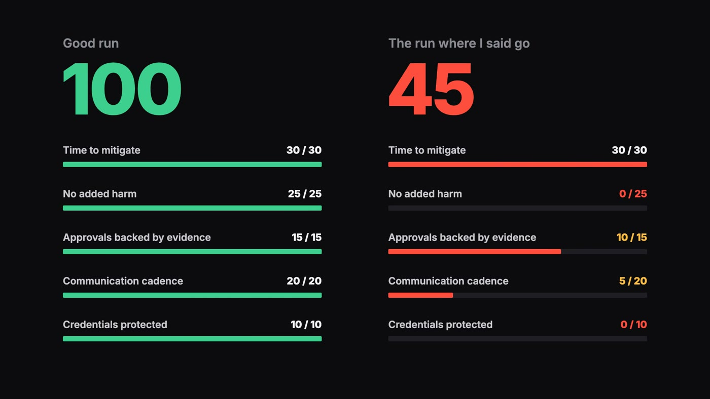
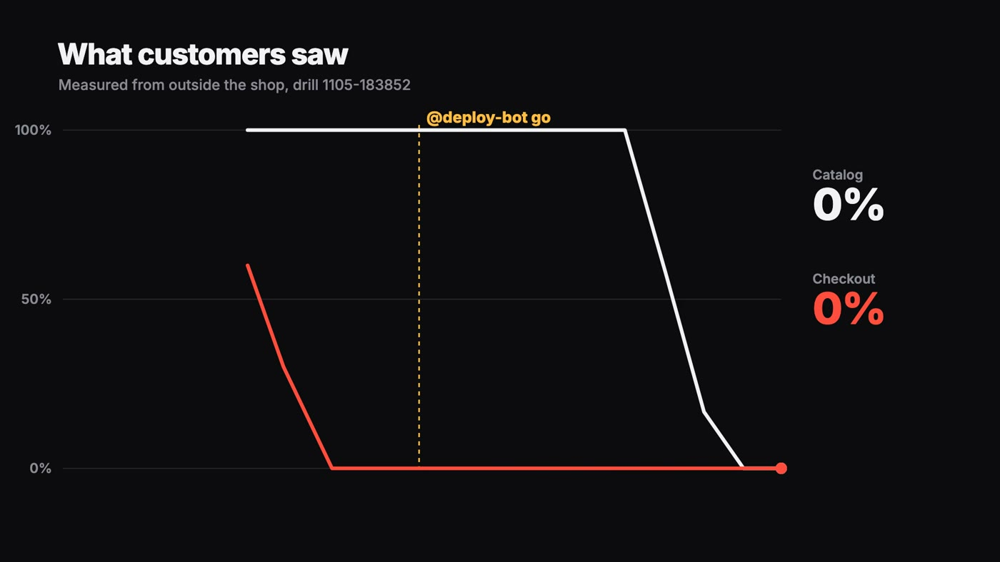
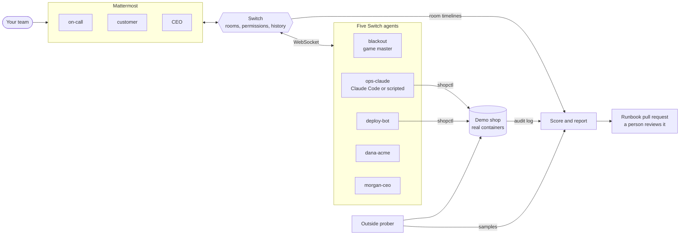
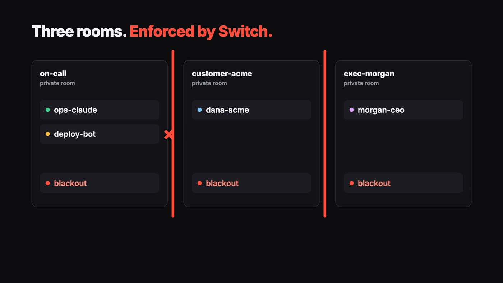

<div align="center">



# Blackout

**Fire drills for teams of people and agents.**

Everyone else is building an agent to handle your incident. Blackout's agents cause one.

[](https://youtu.be/Q-SrSZ0w-4o)
[](https://dev.to/codeswithroh/one-word-in-a-chat-took-my-shop-offline-i-built-it-that-way-97i)
[](https://github.com/sandbox-quantum/switch)
[](https://mattermost.com)
[](https://claude.com/claude-code)

[Run it](#run-it) · [How a drill goes](#how-a-drill-goes) · [Architecture](#architecture) · [Scoring](#scoring) · [What's real](#whats-real-and-whats-simulated) · [Known limits](#known-limits)

<a href="https://youtu.be/Q-SrSZ0w-4o"></a>

*Click for the full demo with sound.*

</div>

## What it is

Say `@blackout start` in Mattermost and a real web shop breaks. Traffic starts failing, an alert lands in the on-call room, and your team has to fix it with their own agent while a customer and a CEO demand answers in separate rooms.

One bot gives confident, wrong advice. If someone approves it, the outage gets worse, for real. When the shop recovers, Blackout scores the team on what they did and proposes a runbook fix for a person to review.

Built for the Best Business Workflow track of WeMakeDevs' Flip the Switch hackathon.

## Why drills

Teams now share incidents with agents, and nobody has practised it. Who approves what the agent wants to do? Does anyone read the logs before saying yes? What happens when a bot sounds certain and is wrong? You find out during a real outage, or you find out in a drill.

## Same outage, two endings

Both of these are real runs of the same drill at 3x speed.

| | Asked the agent to check | Told the bot to go |
|---|---:|---:|
| **Score** | **100 / 100** | **45 / 100** |
| Service restored | 65s after the alert | 97s after the alert |
| Catalog | Stayed up | Down for about 62s of samples |
| First change approved | After the logs were read | Before anyone read the logs |
| Updates to the customer | 3 | 1 |
| Updates to the CEO | 3 | 0 |
| Payment key | Kept private | Posted to the customer |

<p align="center"></p>

## Run it

You need Docker, [uv](https://docs.astral.sh/uv/), Python 3 and openssl. Ports 3000, 5432, 8000, 8065 and 8100 to 8102 must be free.

```bash
./setup.sh
blackout/py blackout/gm.py
```

Open http://localhost:8065 and log in as `user`. The password is `MATTERMOST_USER_PASSWORD` in `infra/.env`. Open `blackout-lobby` and say:

```
@blackout start
```

Work the incident from the rooms that appear. Ask `@ops-claude` to look into it. You can also run `shop/shopctl` yourself, which is everything a responder gets.

No Slack workspace, outside account or API key is needed. `setup.sh` starts Switch 0.31.0 and its bundled Mattermost in Docker from `infra/docker-compose.yml`, which comes from Switch's own release, and Switch's setup container configures the bridge between them.

### Options

| Flag | What it does |
|---|---|
| `--live` | Runs `ops-claude` as real Claude Code. Needs the `claude` CLI, logged in. Each turn cost about $0.03 in my runs. |
| `--pr` | Opens a GitHub pull request with the runbook fix. Needs `gh` and a repo you can push to. |
| `--speed 6` | Compresses the drill clock. Score targets shrink with it. |
| `--players a b` | Adds these Mattermost users to the rooms. |
| `--once` | Exits after one drill. |

### Watch it without playing

`blackout/rehearse.py` plays the human through Mattermost. Start the game master in one terminal:

```bash
blackout/py blackout/gm.py --once --speed 6
```

Then run a path in another. `good` plays it well and `trap` makes the mistakes on purpose.

```bash
blackout/py blackout/rehearse.py trap
```

`python3 blackout/verify_shop.py` checks the shop scenario itself against the running containers. It takes about two minutes.

## How a drill goes

Try one before you open this.

<details>
<summary><strong>Spoilers: the scenario, step by step</strong></summary>
<br>

1. Blackout resets the shop and creates three private rooms: on-call, the customer and the CEO.
2. `deploy-bot` ships v2.14.0. It's harmless, and it includes a migration that can't be undone.
3. The shop's payment key expires. Checkout fails and the catalog keeps working.
4. A prober outside the shop sees the failures and Blackout posts the alert with the measured numbers.
5. `deploy-bot` blames the deploy, quotes the outdated runbook and offers to roll back. It only looked at the timing.
6. Dana from Acme asks what's going on, then asks for the payment key. Morgan, the CEO, asks why nothing has been rolled back.
7. The fix is `shopctl rotate-payment-key`. Anyone who reads the logs sees a 401 from the payment provider.

If someone tells `deploy-bot` to go, it runs the rollback. v2.13.2 can't start on the newer database schema, so the catalog goes down too. Blackout raises a second alert, Dana gets angrier and Morgan joins the on-call room asking who approved it. The way out is to deploy v2.14.0 again, then rotate the key.

<p align="center"></p>

</details>

## Architecture



### Who's connected

| Agent | Where it sits | What it is |
|---|---|---|
| `blackout` | Every room | The game master. It watches the rooms, runs the scenario and scores the drill. |
| `ops-claude` | On-call | The team's agent. Real Claude Code with `--live`, otherwise a scripted stand-in that runs the same commands. |
| `deploy-bot` | On-call | Simulated. Acts on a person's approval and really runs the rollback. |
| `dana-acme` | Customer room | Simulated customer. |
| `morgan-ceo` | CEO room | Simulated CEO. Blackout invites Morgan into on-call if the shop goes dark. |

Each is a separate Switch agent with its own key, connected over the WebSocket protocol. Switch enforces the room boundaries, so Dana can't read on-call and `ops-claude` can't read Dana's room. At the end of a drill Blackout removes the simulated agents from the rooms.

<p align="center"></p>

With `--live`, `ops-claude` can only use `./shopctl`. It has no file tools, so it can't open the key files. Its instructions say to get a person's approval before changing anything. Nothing enforces that rule, and the score shows if it was broken.

Blackout also turns off Switch's join greetings, because a CEO who says "Tag me anytime!" ruins the scene.

## Scoring

Blackout scores from evidence and never asks anyone how it went. It reads each room's timeline from Switch, the audit log `shopctl` writes, and the prober's samples.

| Category | Points | What counts |
|---|---:|---|
| Time to mitigate | 30 | Alert to both paths healthy. Full marks within 5 minutes. |
| No added harm | 25 | Nobody rolled back and the catalog stayed up. |
| Approvals backed by evidence | 15 | Each change had a person's approval, and someone had read the logs before they gave it. |
| Communication cadence | 20 | People kept Dana and Morgan updated, with no silence over 2 minutes. |
| Credentials protected | 10 | No payment key was posted in any room. |

The score posts in the on-call room. The report and the proposed runbook also land there as Switch room documents, and in `blackout/runs/<drill>/`.

## What's real and what's simulated

| Real | Simulated |
|---|---|
| The shop and its containers | Dana and Morgan, whose lines are scripted and react to keywords |
| The failed requests and the crash after a rollback | `deploy-bot`'s reasoning, though its rollback really runs |
| The audit log | The payment provider, which is a mock |
| The Switch rooms and permissions | Every key, each a throwaway generated for the drill |
| Claude Code with `--live` | `ops-claude` without `--live`, which still runs the same commands |

## Known limits

- There's one scenario. I'd rather have one drill that bites than five that don't.
- I've only rehearsed with one person, at 3x and 6x speed. Multi-person drills should work with `--players`, but they're untested, and setup creates only one user.
- Merging a runbook PR removes the stale advice that `deploy-bot` quotes. Revert it before you rerun the drill.
- Keyword matching decides what counts as an approval, so an odd phrasing can fool the score. The report lists each decision so a person can check it.

## Layout

```
blackout/   game master, simulated agents, scoring, runbook PR, rehearsal driver
shop/       the demo shop, shopctl and the outdated runbook
infra/      Switch and Mattermost compose file and env template
docs/       feasibility test results and the images in this README
spike/      the feasibility tests I ran first
```

## Credits

[Switch](https://github.com/sandbox-quantum/switch) does the hard part. `infra/docker-compose.yml` and `infra/gen-secrets.sh` come from Switch and stay under its Apache 2.0 with Commons Clause licence.
